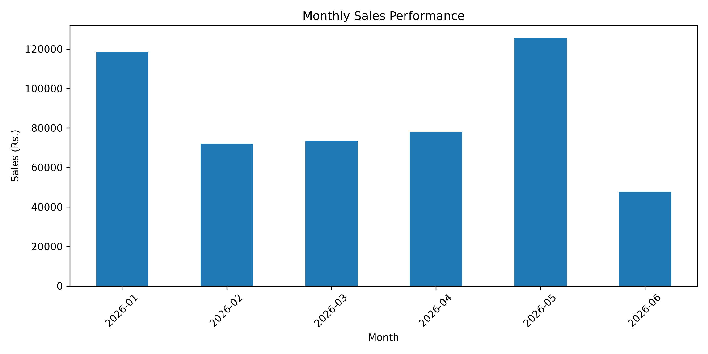
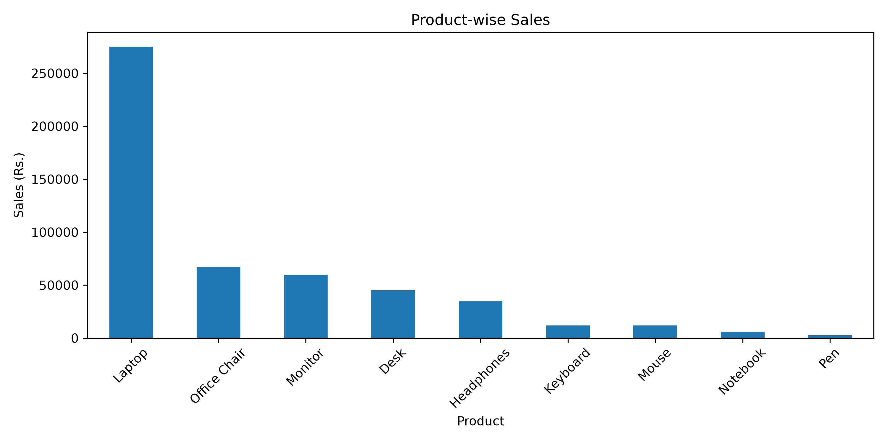
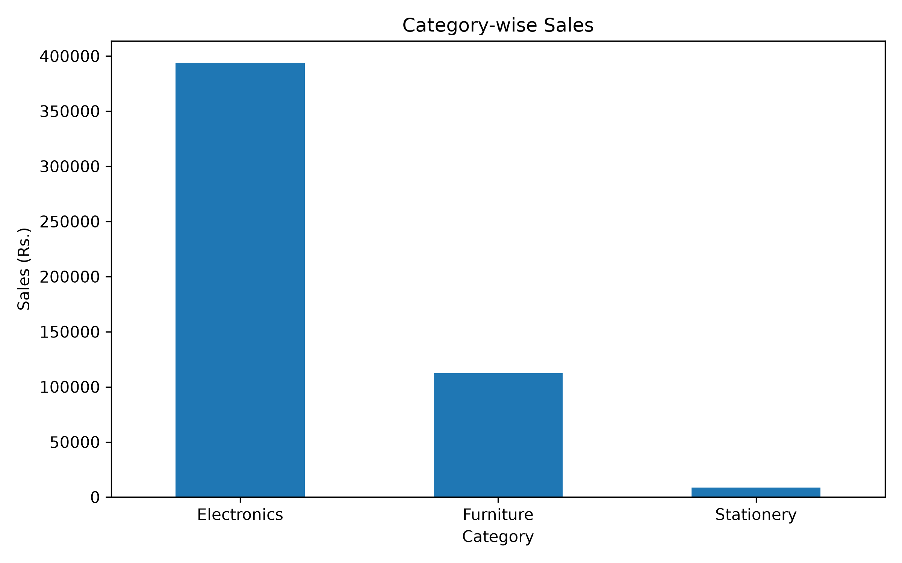
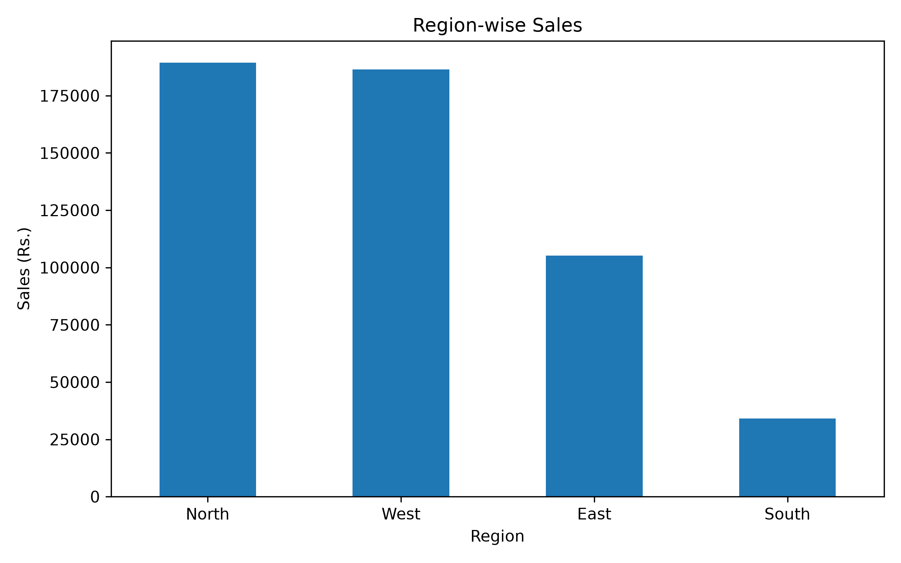

# Python Sales Data Analyzer

A Python-based data analysis project that analyzes retail sales data, checks data quality, and generates useful business insights using Pandas and Matplotlib.

## Project Overview

This project analyzes retail sales data to understand product performance, category revenue, regional sales, and monthly sales trends. It also performs basic data quality checks and generates visual charts to support business decision-making.

## Features

- Data quality checks for missing values and duplicate rows
- Validation of dates, quantities, and prices
- Total sales, total orders, average order value, and units sold
- Product-wise sales analysis
- Category-wise sales analysis
- Region-wise sales analysis
- Monthly sales trend analysis
- Identification of the highest-value order
- Automatic generation of sales charts

## Technologies Used

- Python
- Pandas
- Matplotlib
- CSV

## Key Results

| Metric | Result |
|---|---:|
| Total Sales | ₹5,15,100 |
| Total Orders | 20 |
| Average Order Value | ₹25,755 |
| Total Units Sold | 241 |
| Top-Selling Product | Laptop |
| Best-Performing Category | Electronics |
| Highest-Sales Region | North |
| Best Sales Month | May 2026 |
| Highest-Value Order | ₹1,10,000 |

## Business Insights

- Laptop generated the highest sales among individual products.
- Electronics was the highest-revenue category.
- North recorded the highest regional sales.
- May 2026 was the best month by total sales.
- Order ID 1001 had the highest order value of ₹1,10,000.

## Sales Charts

### Monthly Sales



### Product-Wise Sales



### Category-Wise Sales



### Region-Wise Sales



## Project Files

- `sales_analyzer.py` — Python analysis script
- `sales_data.csv` — Retail sales dataset
- `monthly_sales.png` — Monthly sales chart
- `product_sales.png` — Product-wise sales chart
- `category_sales.png` — Category-wise sales chart
- `region_sales.png` — Region-wise sales chart

## How to Run

### 1. Install Required Libraries

```bash
pip install pandas matplotlib
```

### 2. Keep the Files Together

Make sure `sales_analyzer.py` and `sales_data.csv` are in the same folder.

### 3. Run the Project

```bash
python sales_analyzer.py
```

The sales summary will appear in the terminal, and the generated charts will be saved in the project folder.

## Conclusion

This project demonstrates basic data cleaning, exploratory data analysis, sales reporting, and data visualization using Python.


